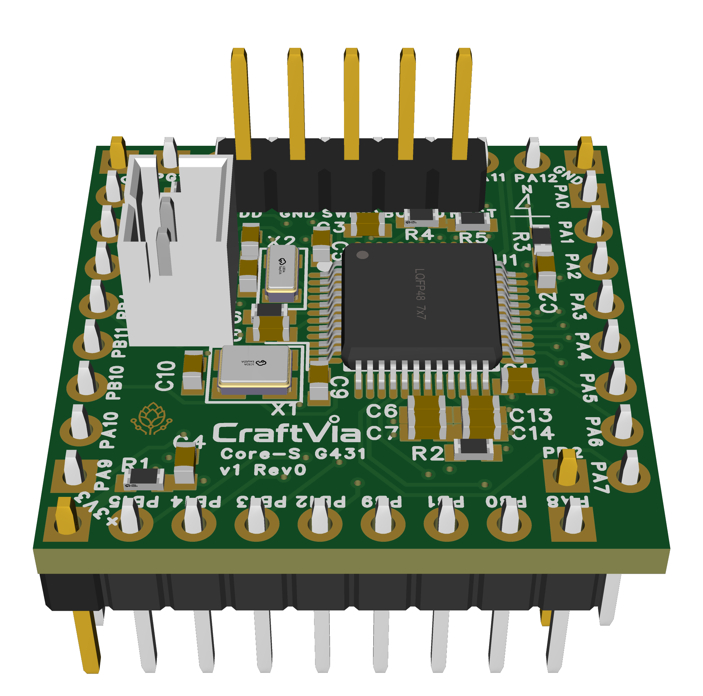

# CraftVia Core-S G431

> [!WARNING]
> **未検証のRev0ハードウェアです**
>
> Rev0基板は発注済みで、現在は到着待ちです。未実装・未通電・未検証であり、実装・使用は自己責任となります。今後のRevisionで設計が変更される可能性があります。

[English](README.md) · [CraftVia](https://craftvia.org/ja/) · [Rev0リリースノート（英語正本）](RELEASE_NOTES.md)

*Rev0 CADレンダリング — [表面](docs/images/2D_PCB1_front_2026-10-26.png) · [裏面](docs/images/2D_PCB1_back_2026-10-26.png)。画像は説明用であり、凍結済みEasyEDAソースとGerberを正とします。*

CraftVia Core-S G431は、STM32G431CBT6を搭載するCore-S v1実装です。25.4 mm角のCore-S外形に、170 MHz Cortex-M4F、SWD、Native USB、Analog/Timer機能、Profileに応じたFDCANをまとめています。

## 現在の状態

| 項目 | 状態 |
| --- | --- |
| 製品Version | v1 |
| PCB Revision | Rev0 |
| 設計 | 初回Prototype製造向けに凍結済み |
| 基板製造 | 発注済み・到着待ち |
| 実装 | 未着手 |
| 実機検証 | 未着手 |
| Release tag | `v1-rev0`を予定 |

## Rev0概要

- MCU: STM32G431CBT6、LQFP48
- CPU: Arm Cortex-M4F、最大170 MHz
- Memory: Flash 128 KiB、SRAM 32 KiB
- PCB: 25.4 mm × 25.4 mm、4層
- 電源: 安定化済み3.3 V入力
- Debug: SWD、N4に物理BOOT0
- USB: N7/N8にNative USB FS
- 標準Clock: HSI16 + PLL、HSI48 + CRS。HSE/LSE optionはDNP
- CAD: EasyEDA

共通の機械・電気要件は[CraftVia共通ドキュメント](https://github.com/craftvia/craftvia-docs)を正とします。製品固有の内容はRev0の[仕様書](docs/specification-v1-rev0.ja.md)と[検証計画](docs/verification-plan-v1-rev0.ja.md)を参照してください。

## 製造上の重要事項

- PCB製造正本は `fabrication/Gerber_PCB1_2026-11-04.zip` です。
- 指定4層Stack-upとUSB 90 ohm差動条件を製造業者と確認してください。
- 標準実装は `P10 + V0 + C0` です。USB/FDCAN、VBAT、Clock optionを変更する前にRelease Notesを確認してください。
- 発注前に `SHA256SUMS.txt` で凍結済み製造ファイルを照合してください。
- 公開用manifestでは、旧staging manifestにあったGerberのPathとDigestの誤りを訂正しています。Gerber本体のbyte列は変更していません。

## ライセンスとブランド

個別表示がない限り、ハードウェア設計ファイルは[CERN-OHL-P-2.0](LICENSE)で提供します。区分は[CraftVia Licensing](LICENSES/README.md)を参照してください。CraftViaの名称とロゴはハードウェアライセンスの対象外です。[Trademark Policy](LICENSES/TRADEMARK_POLICY.md)に従い、改変品や第三者製造品を公式CraftVia製品として表示しないでください。
